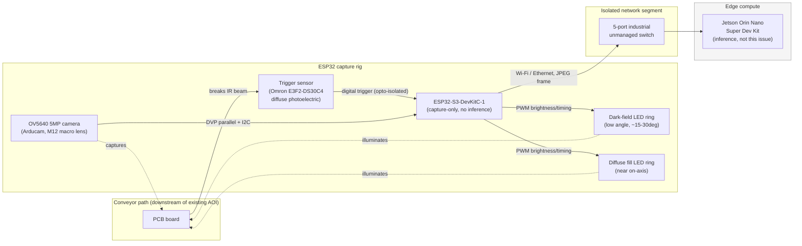

# Hardware Design — ESP32 Vision Rig

Design deliverable for [Issue #2](https://github.com/SreekarCheela/AOI/issues/2). Companion to
[BOM.md](./BOM.md) (part numbers/vendors/prices live there; this doc covers wiring, layout, and
open questions). Nothing here has been physically built or bench-tested — this is the design that
should be reviewed *before* the bench-test step in the issue's acceptance criteria.

## System overview



The edge device's inference pipeline (model, logging, correlation to the existing AOI's verdicts) is
out of scope for this issue — see child issues #3–#5 of the epic. This issue's deliverable ends at
"image arrives at the edge device over the network, inspectable" (acceptance criterion #5).

## Wiring detail — ESP32 side

```
                         +5V (from 24V->5V buck, Pololu D24V50F5)
                              |
        +---------------------+---------------------+
        |                     |                      |
   [ESP32-S3-DevKitC-1]   [NeoPixel ring 1]     [NeoPixel ring 2]
        |                  (dark-field,          (diffuse fill,
        | DVP/I2C           low angle)             near on-axis)
        |                     ^                       ^
   [OV5640 camera]            | GPIO (via 74AHCT125    | GPIO (via 74AHCT125
    module, M12 lens          | level shift 3.3V->5V)  | level shift 3.3V->5V)
    + macro option)           |                        |
                          [ESP32 GPIO A]           [ESP32 GPIO B]

   [Trigger sensor] --24V loop--> [opto-isolator / level-shift stage] --3.3V logic--> [ESP32 GPIO C, interrupt-capable]

   ESP32 Wi-Fi/Ethernet --> [industrial switch] --> Jetson Orin Nano
```

Key wiring notes:
- **Trigger sensor is 12–24VDC NPN**, ESP32 GPIOs are 3.3V and not 5V-tolerant — the trigger line
  needs an opto-isolator (e.g. a simple 4N35-based stage, or an off-the-shelf industrial-to-logic
  interface board) between the sensor and the ESP32, both for voltage safety and to keep the
  ESP32's ground plane isolated from the sensor's 24V loop.
- **NeoPixel data lines** are 5V logic; ESP32 GPIO output is 3.3V, which is out of spec for reliable
  WS2812/SK6812 timing over any cable length — the 74AHCT125 (or equivalent single-gate level
  shifter) is inline on each ring's data line.
- **Camera interface**: OV5640 in DVP (parallel) mode uses the ESP32-S3's dedicated LCD_CAM
  peripheral pins plus an I2C pair (SCCB) for sensor configuration — standard Arducam wiring
  diagram for their ESP32-S3 camera module applies as-is, no custom work needed here.
- **Power domains**: sensor/lighting on the 24V Mean Well supply (stepped down to 5V locally for
  the ESP32 and LEDs), Jetson on its own separate 19V Mean Well supply. Both supplies are
  independent from line control power per the epic's requirement — neither should share a circuit
  with conveyor motor drives or existing AOI equipment.

## Resolution rationale (camera + lens choice)

The epic's placeholder assumption is 0402/0201 passives, ~0.3–0.5mm smallest features. Rule of thumb
for machine vision: you want at least 2–3 pixels across the smallest feature you need to
distinguish (Nyquist-ish sampling for a *detectable* defect, more like 5–10px if the model needs to
characterize joint shape, not just detect presence).

At 5MP (OV5640, 2592×1944):
- If the frame covers a **single joint or small cluster** (e.g. a 15mm × 11mm field of view): GSD ≈
  15mm / 2592px ≈ **0.0058mm/px** — a 0.3mm feature is ~52px across. Very comfortable margin.
- If the frame covers a **whole small board** (e.g. 100mm × 75mm): GSD ≈ 100mm / 2592px ≈
  **0.039mm/px** — a 0.3mm feature is ~8px across. Workable but tight, especially for texture/
  reflectivity cues rather than just presence/absence.
- If the frame needs to cover a **larger board** (150mm+): GSD gets worse than ~0.06mm/px, and 5MP
  likely under-resolves 0.3mm features enough to matter.

This is exactly why the camera/lens spec is flagged as a placeholder in the issue and epic: the
right answer depends on (a) the actual finest feature size (checklist item 4) and (b) whether the
MVP's whole-board classification (per the epic's model plan) needs the *whole board* in one frame,
or whether the ESP32 can capture a tiled/scanned sequence of closer crops per board. The M12 macro
lens option in the BOM is chosen specifically to keep that door open — a macro lens with a smaller
FOV trades board coverage for resolution, which may be the right tradeoff if per-joint cues matter
more than whole-board framing.

## Lighting rationale (recap — full detail in BOM.md §3)

Solder-joint defect classes called out in the epic (insufficient solder, bridging, tombstoning,
cold/dull joints, misalignment) are primarily visible via **shape and reflectivity**, not color. A
good fillet is smooth and concave, reflecting light specularly (bright, mirror-like highlight at the
right viewing/lighting angle); a cold/dull joint is grainy and scatters light diffusely (looks dull
even under the same light). Bridging and insufficient solder are shape/geometry cues, best served by
directional low-angle light that throws shadows at solder-fillet edges.

The two-ring dark-field + diffuse-fill design is a scaled-down version of the same principle
commercial AOI machines use with dome/multi-angle lighting — full dome lighting is out of budget/
complexity for a DIY rig, but two rings at different angles gets most of the same contrast benefit.

## Mounting and physical layout

Immediately downstream of the existing AOI station, same conveyor path, per the epic's "Mounting"
architecture decision. The rig sits on an 80/20 T-slot frame straddling or beside the conveyor,
with the camera/lighting head on an adjustable arm positioned above the board path and the trigger
sensor mounted at conveyor-edge height, upstream of the camera by a fixed distance calibrated to the
conveyor speed (so there's a known, consistent delay between trigger-fire and board-under-camera).

**This issue's design does not fix exact dimensions or clearances** — see Assumptions section below.
That's explicitly deferred to physical install (issue #2 in the epic's child-issue table, "Physical
install at line station"), which depends on the line safety/guarding sign-off.

## Bench-test plan (for the capture-chain validation in acceptance criteria #3–#5)

1. Power up ESP32 + camera + lighting rig on bench power (not yet the Mean Well supplies — USB is
   fine for this step).
2. Trigger sensor bench test: wave a sample board/object past the sensor, confirm reliable digital
   edge on the ESP32 GPIO across multiple trials, at multiple approach speeds/angles if possible.
3. Wire trigger → ESP32 interrupt → camera capture; confirm each trigger event produces exactly one
   JPEG frame (no double-fires, no missed triggers) against a bench-simulated board pass.
4. Lighting bench validation: capture sample solder joints (need physical PCB samples — separate
   from this design deliverable) under both rings at a few angle/brightness combinations, visually
   confirm specular/diffuse contrast is visible before locking the mount geometry.
5. Network hop: ESP32 → industrial switch → Jetson, confirm image lands on the Jetson's filesystem
   and is openable/inspectable (satisfies criterion #5, minus the "full chain on a bench setup"
   wording which also wants the trigger-to-image path timed end-to-end).

None of this has been executed yet — it's the next step after this design is reviewed.

## ASSUMPTIONS PENDING CONFIRMATION

This BOM/design is built on placeholders for exactly the three pre-flight checklist items the issue
calls out as dependencies (checklist items 4–6 from the epic, [Issue #1](https://github.com/SreekarCheela/AOI/issues/1)):

1. **Finest joint/component size (checklist item 4)** — assumed 0402/0201 passives, ~0.3–0.5mm
   features, per the epic's own placeholder. **Action needed: get the real answer from the BOM
   owner.** If the real answer is coarser (e.g. no components smaller than 0603), the OV5640 5MP
   choice has comfortable headroom and could even be relaxed to save cost. If finer (e.g. 01005
   passives or fine-pitch BGA), 5MP is very likely insufficient and this BOM's camera section
   (§1) needs revisiting — likely a higher-resolution sensor and/or true macro lens with a much
   smaller field of view, possibly requiring a multi-shot tiling approach per board rather than one
   frame per board.

2. **Line safety/guarding sign-off (checklist item 5)** — this design assumes there's room to mount
   a T-slot frame + camera arm + trigger sensor immediately downstream of the existing AOI without
   interfering with conveyor guarding, e-stops, or existing fixtures. **Action needed: physical site
   walk with whoever owns line safety**, before any bracket dimensions or mounting hole locations are
   finalized. This design deliberately stops short of fixed dimensions for exactly this reason (see
   Mounting section above and BOM.md §5).

3. **Plant IT/network capacity check (checklist item 6)** — this design assumes the ESP32 + Jetson
   can sit on a fully isolated, air-gapped network segment via a dedicated unmanaged switch, with no
   image traffic touching plant infrastructure at all. **Action needed: confirm with plant IT**
   whether that's acceptable, or whether there are constraints (e.g. needing to route through an
   existing switch for cable-run reasons, needing VLAN tagging instead of physical isolation, or
   needing to expose the Jetson somewhere IT can reach it for maintenance). If a fully air-gapped
   segment isn't feasible, the network isolation gear in BOM.md §6 needs to change from an unmanaged
   to a managed/VLAN-capable switch (~$100–150 more).

Until these three are resolved, this BOM/design should be treated as a **starting point for review**,
not a final order list — consistent with the issue's framing ("Depends On: Pre-flight checklist items
4-6 ... should be resolved or in progress before finalizing camera/lens spec and network design").
